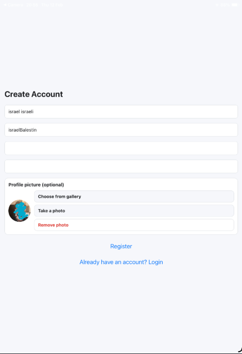
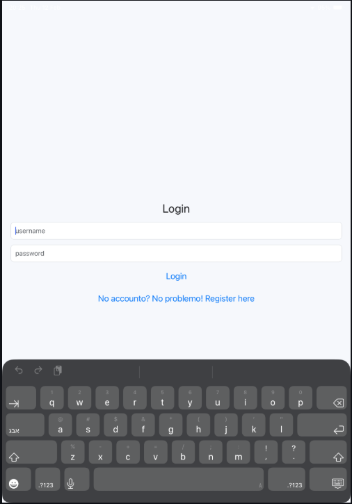
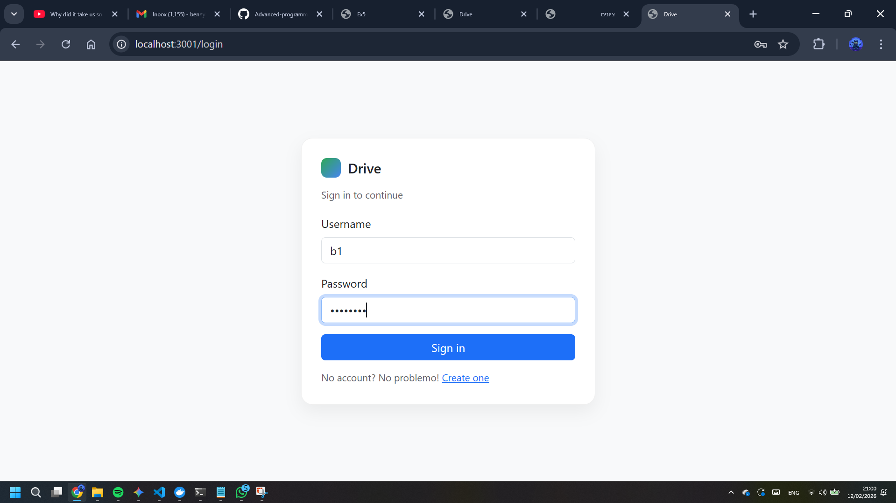
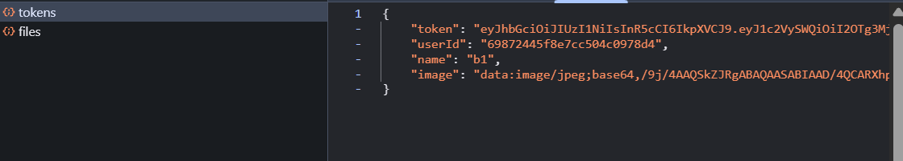
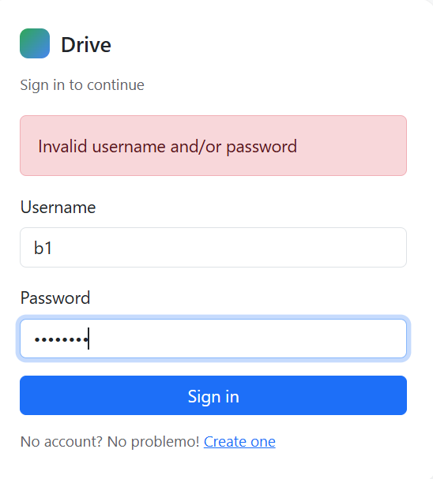
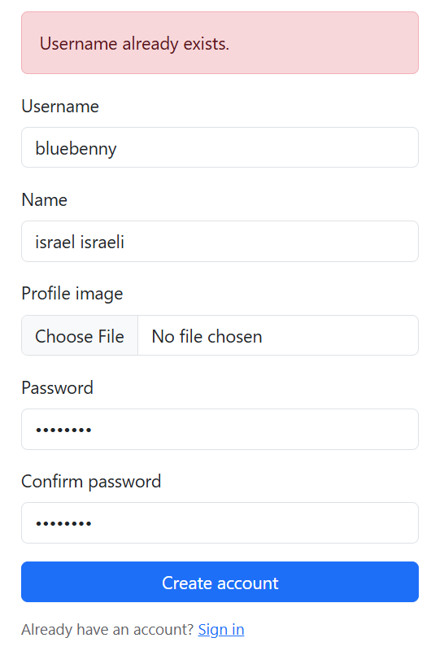
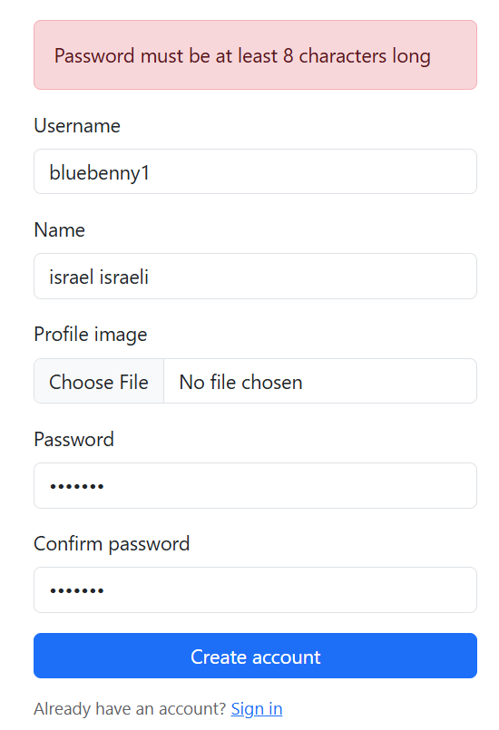
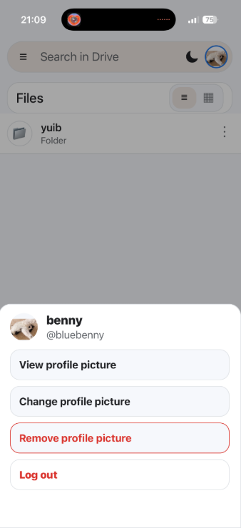

---

# Authentication & User Management

This page documents the user authentication system, including the registration and login processes, input validation logic, and the visual feedback provided to the user.

### 1. Registration Process

The registration screen allows new users to create an account.

* 
**Mandatory Fields:** All input fields (Username, Display Name, Password, and Password Verification) are strictly mandatory.

* 
**Image Selection:** Users can select an existing image from their device's gallery or take a new picture from their mobile device's camera. The system displays a preview of the selected image before the registration is submitted.

* **Visual Proof:**
* 

### 2. Login Flow

Once registered, users can access the system by providing their credentials.

* 
**Credential Verification:** The system validates the username and password against the MongoDB database.

* 
**JWT Authentication:** Upon a successful login, the server issues a JSON Web Token (JWT) that is used to authorize all subsequent requests to the API.

* **Visual Proof:**
* 
* 
* 

### 3. Input Validation & Visual Feedback

The system includes logic to prevent invalid data entry and ensure the user understands any errors.

* 
**Password Complexity:** Passwords must be at least 8 characters long and include a combination of letters and numbers.

* **Specific Error Scenarios:**
* 
**Invalid Credentials:** If the username or password is incorrect, a clear "Invalid username or password" message is displayed.

* 
**Duplicate Username:** If a user attempts to register with a username that is already taken, the system provides a specific error notification.

* 
**Validation Errors:** Missing fields or mismatched passwords trigger immediate visual feedback.

* **Visual Proof:**
* 
* 
* 

### 4. Session Management

* 
**Logout:** Clicking the logout button in the side-drawer menu (mobile) or top menu (web) terminates the session and redirects the user to the login screen.

* 

---
