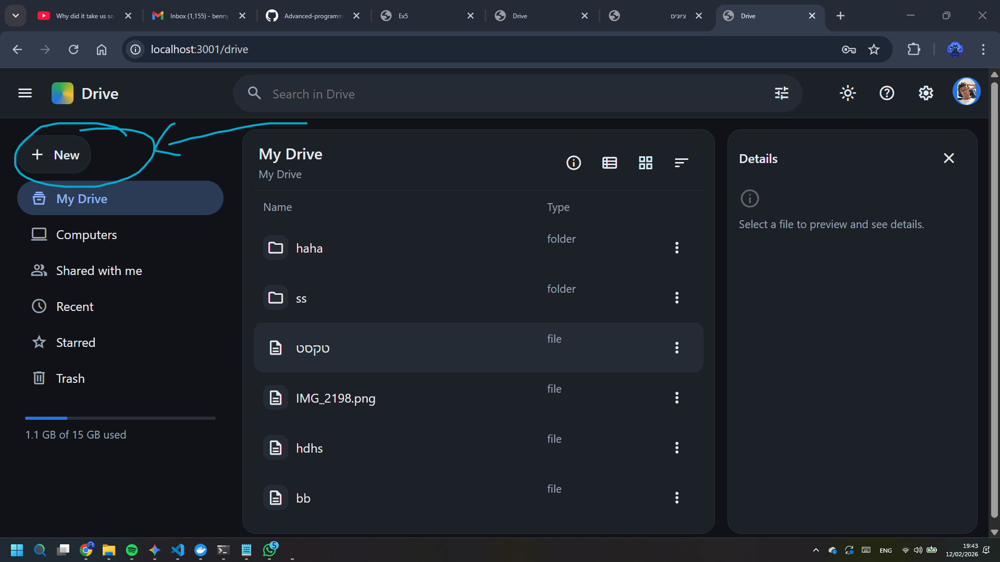
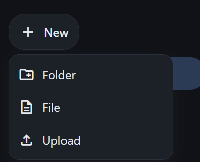
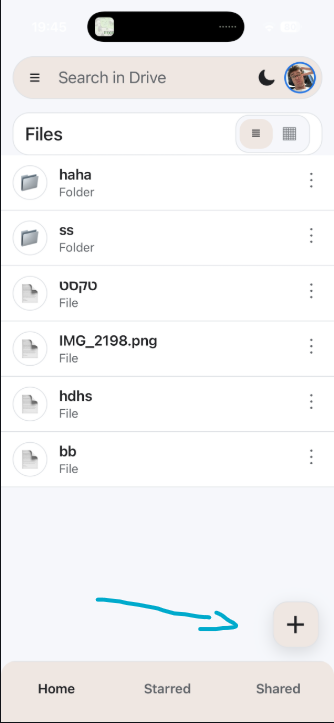
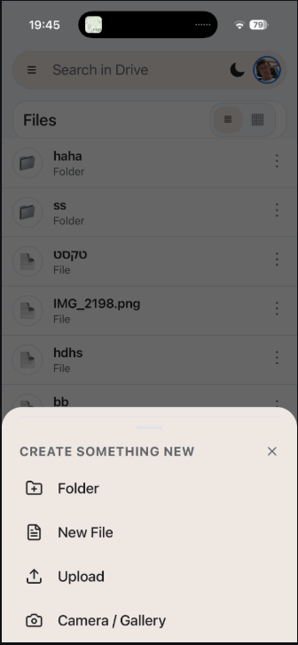

---

# File & Folder Management

This page demonstrates the core functionality of the system, showing how files and folders are managed across the Web, Mobile, and C++ clients.

### 1. Creating Content

The system allows users to create new folders and upload/create files. These actions are performed through the Node.js Web Server and persisted in the C++ backend.
 
 

* 
**Web Client:** Users can use the "New" button to create folders or upload files directly to the root or sub-directories.

* 
**Mobile Client:** The React Native app provides an interface to add new content, following the design language of Google Drive for mobile.

* **Verification:**
* [Placeholder: Screenshot of creating a folder named "Project_Docs" on the Web Client]
* [Placeholder: Screenshot of the same folder appearing instantly on the Mobile Client]

### 2. Editing and Viewing

The system supports viewing and modifying existing files and folders.

* 
**File Viewing:** Opening a text file displays its content for reading or editing, while images are rendered directly within the app.

* **Renaming:** Users can rename files or folders. This change triggers a `PATCH` request to the API, which updates the record in MongoDB and the physical file metadata in the C++ backend.

* **Verification:**
* [Placeholder: Screenshot showing the "Edit" interface for a text file]
* [Placeholder: Screenshot of a file name being changed and successfully saved]

### 3. Deletion and Trash

Deleting a file or folder removes it from the active view. The process involves a `DELETE` request to the server, which handles the removal of both the database entry and the physical storage.

* 
**Logic:** Deleting a folder recursively removes all its contents to maintain system integrity.

* **Verification:**
* [Placeholder: Screenshot of the "Delete" confirmation dialog]
* [Placeholder: Screenshot of the file list after successful deletion]

### 4. Search and Synchronization

A key requirement is that all clients see the same dynamic state from the server.

* 
**Global Search:** Searching for a keyword returns all matching files and folders based on their names or content.

* 
**Cross-Client Sync:** Because the React and React Native apps communicate with the same Node.js API, any change made on one client is immediately visible on the other upon refresh or navigation.

* **Verification:**
* [Placeholder: Screenshot of search results for a specific query]
* [Placeholder: Screenshot showing the C++ client's `GET` command returning the same list of files seen in the Web UI]

---

### Implementation Notes

* 
**API Layer:** All file operations use the `/api/files` endpoint.

* 
**Backend Communication:** The Node.js server acts as a client to the C++ server (Ex2) to perform physical file operations using TCP sockets.

* 
**Data Integrity:** All metadata, including names and permissions, is stored in MongoDB via Mongoose.
