---

# File & Folder Management

This page demonstrates the core functionality of the system, showing how files and folders are managed across the Web, Mobile, and C++ clients.

### 1. Creating Content

The system allows users to create new folders and upload/create files. These actions are performed through the Node.js Web Server and persisted in the C++ backend.

* 
**Web Client:** Users can use the "New" button to create folders or upload files directly to the root or sub-directories.
 

* 
**Mobile Client:** The React Native app provides an interface to add new content and reach your files and folders

 

* **Verification:**
* 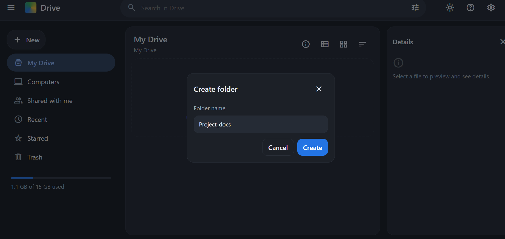
* 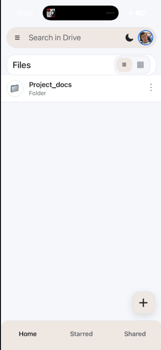

### 2. Editing and Viewing

The system supports viewing and modifying existing files and folders.

* 
**File Viewing:** Opening a text file displays its content for reading or editing, while images are rendered directly within the app.

* **Renaming:** Users can rename files or folders. This change triggers a `PATCH` request to the API, which updates the record in MongoDB.

* **Verification:**
* 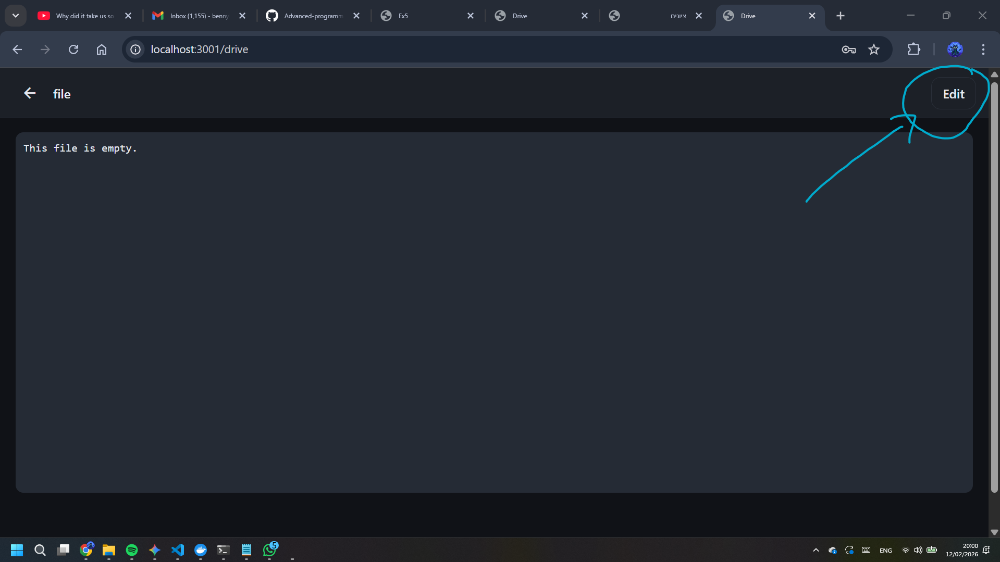
* 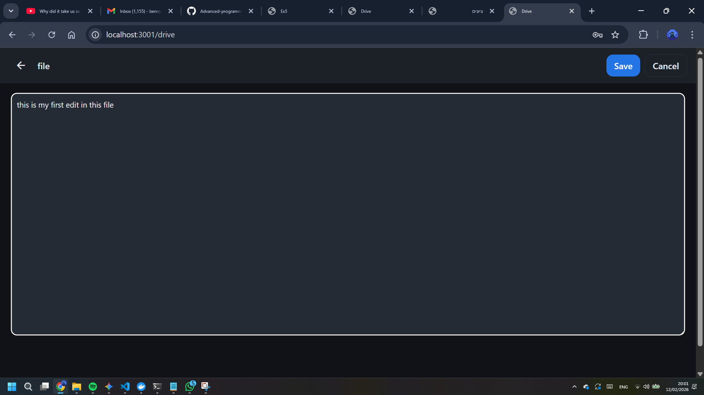
* 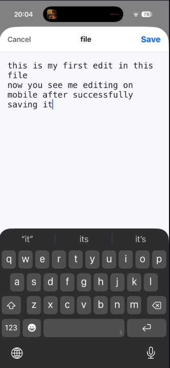
* 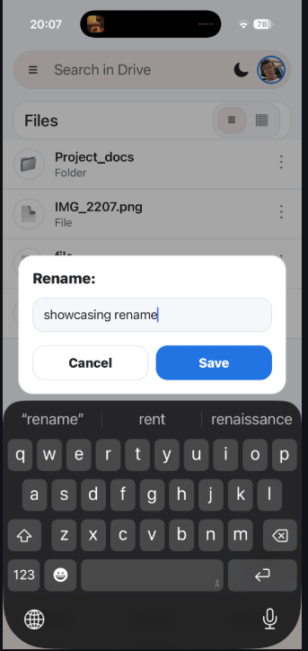

### 3. Deletion and Trash

Deleting a file or folder removes it from the active view. The process involves a `DELETE` request to the server, which handles the removal of both the database entry and the physical storage.

* 
**Logic:** Deleting a folder recursively removes all its contents to maintain system integrity.

* **Verification:**
* [move to trash](./imagesProof/move_to_trash.png)
* [trash bin](./imagesProof/trash_bin.png)
* 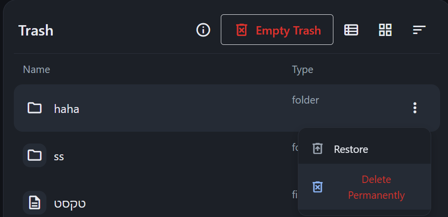
* 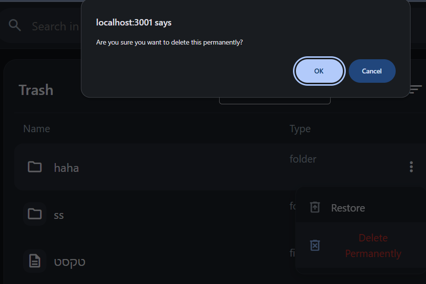
* 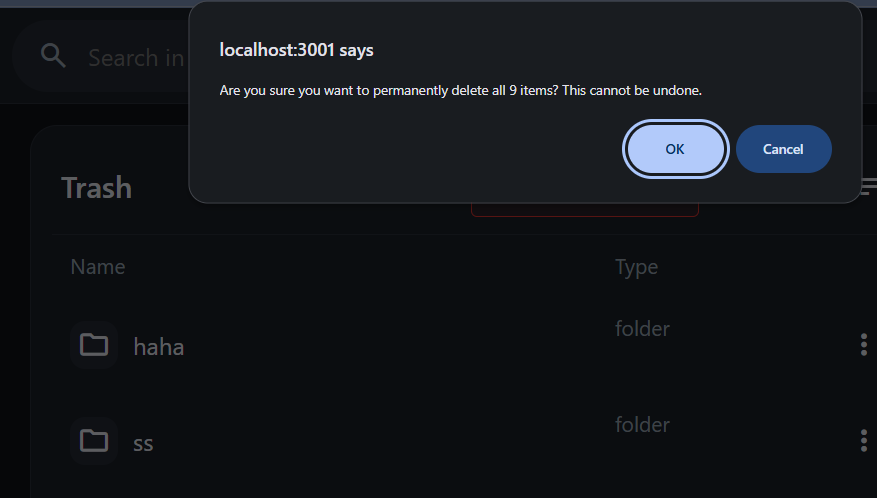

### 4. Search and Synchronization

A key requirement is that all clients see the same dynamic state from the server.

* 
**Global Search:** Searching for a keyword returns all matching files and folders based on their names or content that the user has view or above permissions for.
Note: the search algorithm is not ideal since backend searches the query in the file name, so if the query matches the physical file name (the one given by the system) we fetch the file contnet to exclude it from the returned files list.

* **Verification:**
* 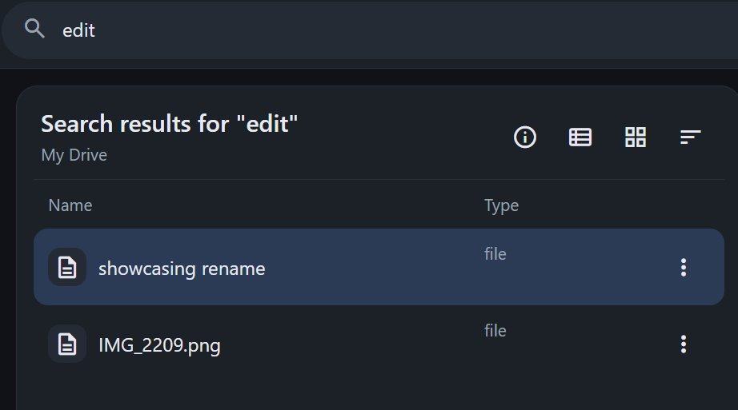
* 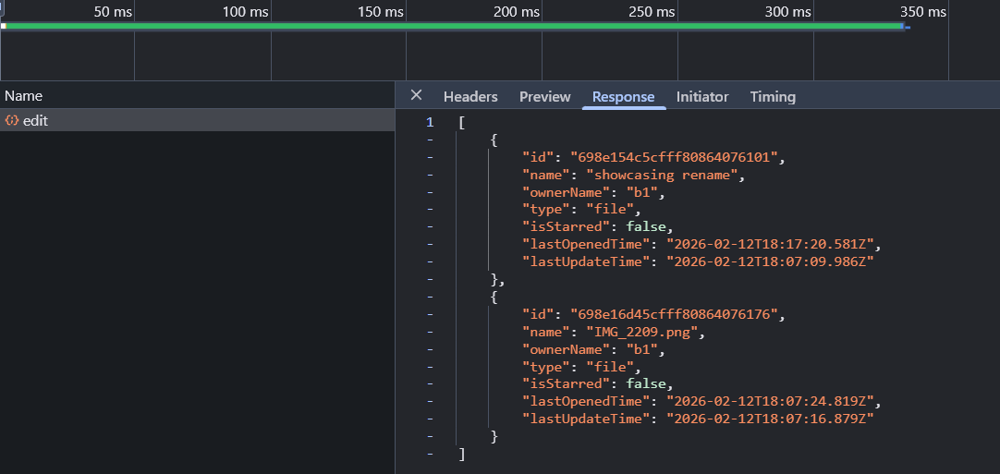

* 
**Cross-Client Sharing:** since this is a google drive-like system one of its key ideas is the option to share files and folders between users. For this demo ill open 2 users, one on my ipad and one on the web browser. the ipad user will have a profile pic of my cat and it will be in dark mode for clarity.

* **Verification:**
* 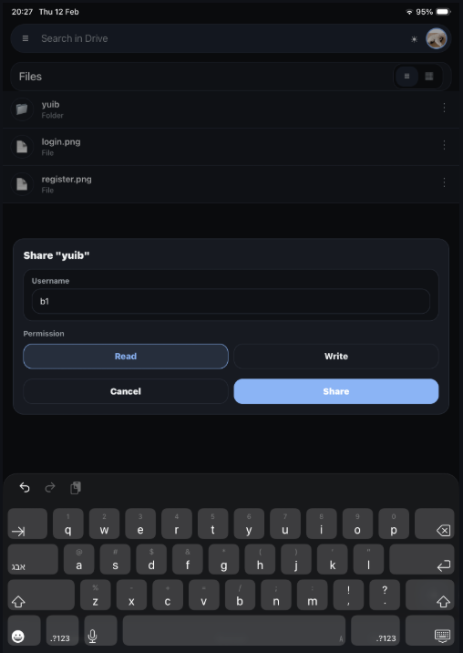
* 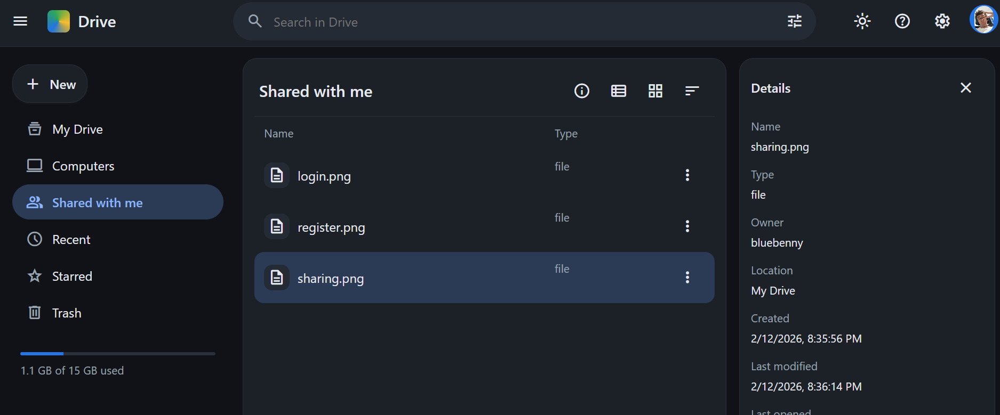

---

### Implementation Notes

* 
**API Layer:** All file operations use the `/api/files` endpoint.

* 
**Backend Communication:** The Node.js server acts as a client to the C++ server (from Ex2) to perform physical file operations using TCP sockets and the cpp server multithreads all requests.

* 
**Data Integrity:** All metadata, including names and permissions, is stored in MongoDB via Mongoose.
